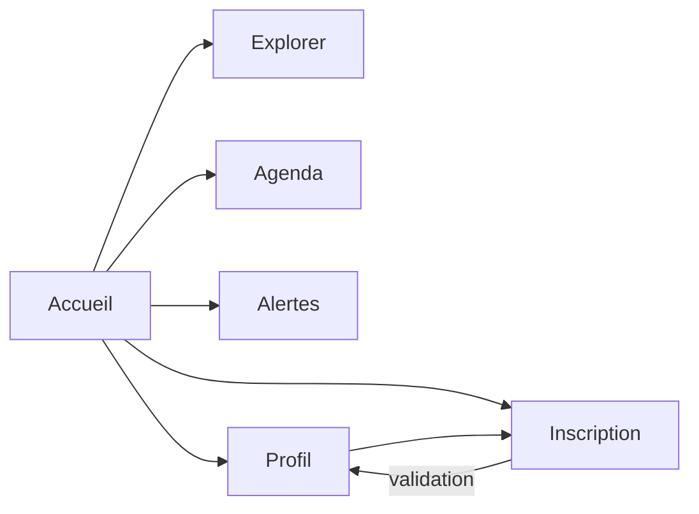

# CampuGO


Application mobile **.NET MAUI** dédiée à la vie de campus de l’**Université de Douala** et de l’**École Nationale Supérieure Polytechnique de Douala (ENSPD)**. Elle regroupe en une seule interface les lieux, les événements, les alertes et le profil de l’étudiant.

> **Statut : prototype.** Les contenus affichés (lieux, événements, alertes, noms) sont des **données d’exemple** embarquées dans l’application. Aucun service distant n’est utilisé.

## Sommaire

1. [Fonctionnalités](#fonctionnalités)
2. [Stack technique](#stack-technique)
3. [Architecture](#architecture)
4. [Prérequis](#prérequis)
5. [Installation et lancement](#installation-et-lancement)
6. [Personnalisation](#personnalisation)
7. [Dépannage](#dépannage)
8. [Limites connues et feuille de route](#limites-connues-et-feuille-de-route)
9. [Historique du dépôt](#historique-du-dépôt)
10. [Crédits](#crédits)
11. [Auteur](#auteur)

## Fonctionnalités

| Écran | Description |
|---|---|
| **Accueil** | Photographie du campus de l’ENSPD, puis invitation à créer un compte (ou salutation personnalisée) ; logotype ENSPD dans la barre du haut. |
| **Explorer** | Recherche textuelle et filtres par catégorie (Activités, Services, Restauration). |
| **Agenda** | Sélecteur de jours (sept jours glissants) et programme du jour : heure, lieu, catégorie. |
| **Alertes** | Informations du campus, avec mise en évidence des alertes urgentes. |
| **Profil** | Informations du compte étudiant et suppression du profil enregistré sur l’appareil. |
| **Créer un compte** | Inscription étudiante avec validation complète (voir ci-dessous). |

### Inscription étudiante

Le formulaire est organisé en trois blocs :

- **Identité** : nom complet, adresse e-mail, téléphone facultatif au format camerounais (`+237`, 9 chiffres commençant par 6).
- **Parcours** : établissement, filière (liste dépendante de l’établissement), niveau et campus (pré-rempli selon l’établissement).
- **Sécurité** : mot de passe (8 caractères minimum, un chiffre, une majuscule), indicateur de robustesse, confirmation et bascule afficher/masquer.

Chaque champ affiche son message d’erreur sous la saisie. Après validation, le profil est enregistré **localement sur l’appareil** (`Preferences`). **Le mot de passe n’est pas stocké** : aucun serveur d’authentification n’existe à ce stade.

### Contexte couvert

- **Campus** : Bassa (Cité SIC), Ndogbong, Logbessou, Akwa.
- **Établissements** : ENSPD, IUT, ENSET, ESSEC, FSEGA, FS, FMSP, FLSH.

## Stack technique

| Élément | Valeur |
|---|---|
| Framework | .NET MAUI (`net10.0-android`) |
| Langages | C# et XAML |
| SDK Android | Cible API 36, minimum API 21 |
| Interface | Construite par code (classe partielle `MainPage`, un fichier par écran) |
| Persistance | `Microsoft.Maui.Storage.Preferences` |
| Polices | Inter (Regular, SemiBold) |
| Icônes | Material Icons (police d’icônes vectorielles) |
| Outillage | VS Code, C# Dev Kit, .NET MAUI extension |

## Architecture

```
CampuGO/
├── App.xaml / App.xaml.cs        Point d’entrée, dictionnaires de ressources
├── AppShell.xaml                 Shell avec une page unique (MainPage)
├── MainPage.xaml                 Structure : barre du haut, zone défilante, barre de navigation
├── MainPage.xaml.cs              Noyau : navigation avec historique, barres du haut et du bas
├── MainPage.Components.cs        Composants réutilisables (cartes, listes, boutons, lignes)
├── MainPage.Home.cs              Écran Accueil
├── MainPage.Explore.cs           Écran Explorer (recherche, filtres)
├── MainPage.Agenda.cs            Écran Agenda
├── MainPage.Alerts.cs            Écran Alertes
├── MainPage.Profile.cs           Écran Profil
├── MainPage.Signup.cs            Écran Créer un compte (formulaire et validation)
├── Theme.cs                      Jetons de design : couleurs, polices, rayons
├── Icons.cs                      Icônes (Material Icons)
├── CampusData.cs                 Données d’exemple (campus, établissements, événements…)
├── UserProfile.cs                Modèle de profil et persistance locale
├── MauiProgram.cs                Configuration de l’application et des polices
├── Resources/
│   ├── Styles/                   Colors.xaml, Styles.xaml
│   ├── Fonts/                    Inter, Material Icons, Open Sans
│   ├── AppIcon/ · Splash/        Icône et écran de démarrage
│   └── Images/                   Photographie du campus et logotype ENSPD
├── Platforms/                    Code spécifique Android, iOS, MacCatalyst, Windows
└── .vscode/tasks.json            Tâches de lancement sur l’émulateur
```

### Navigation

La navigation est gérée par la classe `MainPage` : chaque changement d’écran passe par `NavigateTo`, qui mémorise l’écran quitté dans un **historique**. Dès que l’historique n’est pas vide, une **flèche de retour apparaît en haut à gauche** de la barre du haut ; elle (et le bouton retour d’Android) ramène à l’écran précédent via `GoBack`. L’écran de création de compte masque la barre du bas pour concentrer l’attention sur le formulaire.



### Données et persistance

- `CampusData` est une classe statique en lecture seule : toute modification de contenu se fait dans ce fichier.
- `UserProfile` sérialise sept champs (nom, e-mail, téléphone, établissement, filière, niveau, campus) dans `Preferences` sous le préfixe `profile.`. `Clear()` les supprime.

## Prérequis

- **.NET 10 SDK** avec la charge de travail Android : `dotnet workload install maui-android`
- **JDK 17**
- **Android SDK** : `platform-tools`, `emulator`, `platforms;android-36`
- **VS Code** avec les extensions *C# Dev Kit* et *.NET MAUI*
- Sous Linux, **KVM** pour un émulateur fluide : `sudo apt install qemu-kvm`, puis `sudo adduser $USER kvm` et reconnexion

Les chemins ci-dessous supposent une installation utilisateur sous Linux (`~/.dotnet`, `~/.local/share/jdk17`, `~/Android/Sdk`). Adapte-les à ta machine.

## Installation et lancement

### 1. Variables d’environnement

À placer dans `~/.bashrc` (puis `source ~/.bashrc`) ou à exécuter dans chaque nouveau terminal :

```sh
export DOTNET_ROOT="$HOME/.dotnet"
export JAVA_HOME="$HOME/.local/share/jdk17"
export ANDROID_HOME="$HOME/Android/Sdk"
export ANDROID_SDK_ROOT="$HOME/Android/Sdk"
export PATH="$DOTNET_ROOT:$JAVA_HOME/bin:$ANDROID_HOME/emulator:$ANDROID_HOME/platform-tools:$ANDROID_HOME/cmdline-tools/latest/bin:$PATH"
```

### 2. Récupérer le projet

```sh
git clone <url-du-depot>
cd CampuGO
```

### 3. Créer l’émulateur (une seule fois)

```sh
sdkmanager "platform-tools" "emulator" "platforms;android-36" "system-images;android-36;google_apis;x86_64"
avdmanager create avd -n CampuGO_API_36 -k "system-images;android-36;google_apis;x86_64" -d pixel_7
emulator -list-avds
```

### 4. Lancer avec les tâches VS Code

Ouvre le dossier racine (celui qui contient `CampuGO.csproj`) dans VS Code, puis `Ctrl+Shift+P` → **Tasks: Run Task** :

1. **CampuGO: 1. Démarrer l’émulateur Android**
2. **CampuGO: 2. Vérifier l’émulateur (adb devices)** — la liste doit afficher `emulator-5554  device`
3. **CampuGO: 3. Lancer sur l’émulateur (Debug)**

### 5. Lancer depuis le terminal

Terminal 1 (laisser ouvert) :

```sh
emulator -avd CampuGO_API_36 -gpu host -no-snapshot-save
```

Terminal 2, une fois l’écran d’accueil Android affiché :

```sh
adb devices
dotnet build CampuGO.csproj -f net10.0-android -t:Run
```

### 6. Générer et installer un APK

```sh
dotnet build CampuGO.csproj -c Release -f net10.0-android
adb install -r bin/Release/net10.0-android/com.campugo.app-Signed.apk
adb shell monkey -p com.campugo.app 1
```

Sur un téléphone réel : activer le **débogage USB**, brancher l’appareil et vérifier avec `adb devices`.

## Personnalisation

| Objectif | Fichier |
|---|---|
| Modifier campus, établissements, filières, lieux, événements, alertes | `CampusData.cs` |
| Modifier couleurs, polices et rayons | `Theme.cs` |
| Modifier les styles par défaut des contrôles | `Resources/Styles/Styles.xaml` |
| Changer l’icône ou l’écran de démarrage | `Resources/AppIcon/`, `Resources/Splash/` |
| Changer l’identifiant de l’application | `ApplicationId` dans `CampuGO.csproj` |

## Dépannage

| Symptôme | Cause probable | Solution |
|---|---|---|
| `dotnet : commande introuvable` | `PATH` non défini dans ce terminal | Exécuter les variables d’environnement de l’étape 1 |
| `MSB1009 : le fichier projet n’existe pas` | Terminal hors du dossier du projet | `cd` vers le dossier contenant `CampuGO.csproj` |
| `XA0010 : Aucun appareil disponible` | Aucun émulateur ni téléphone connecté | Démarrer l’émulateur, puis vérifier `adb devices` |
| `adb devices` affiche une liste vide ou `offline` | Émulateur encore en démarrage | Attendre, puis `adb kill-server && adb start-server` |
| `emulator : commande introuvable` | `$ANDROID_HOME/emulator` absent du `PATH` | Revoir l’étape 1 |
| Émulateur très lent | KVM indisponible | Vérifier `ls /dev/kvm` et l’appartenance au groupe `kvm` |
| Comportement incohérent après modification | Artefacts de compilation obsolètes | `dotnet clean`, puis relancer |

## Limites connues et feuille de route

- **Écarts avec la maquette Figma** : la maquette décrit huit écrans (connexion, fil d’annonces, détail, événements, annuaire, favoris, administration). L’application en implémente une partie sous une forme simplifiée. La palette et la police (Inter) reprennent celles de la maquette.
- **Architecture** : l’interface est construite par code dans une seule classe `MainPage`, répartie en fichiers partiels. Une migration vers des pages XAML dédiées, `Shell` et MVVM améliorerait la maintenabilité et permettrait les liens profonds.
- **Données** : le contenu est statique. Une API ou une base locale (SQLite) permettrait un contenu dynamique et un mode hors-ligne.
- **Authentification** : le compte est un profil local, sans mot de passe stocké ni connexion.
- **Tests** : aucun test automatisé pour l’instant.
- **Accessibilité** : les libellés `AutomationProperties` ne sont définis que sur quelques contrôles.

## Historique du dépôt

L’historique est organisé par phase d’intégration des interfaces, puis par fonctionnalité ajoutée.

| Commit | Contenu |
|---|---|
| `phase-a` | Socle .NET MAUI, thème, navigation par onglets, écran Accueil |
| `phase-b` | Écrans Explorer (recherche et filtres) et Agenda |
| `phase-c` | Écrans Alertes et Profil |
| `feat` | Inscription étudiante avec validation, établissements et campus de Douala |
| `feat` | Enregistrement local du profil étudiant |
| `chore` | Tâches VS Code pour l’émulateur Android |
| `docs` | README technique |
| `feat` | Refonte de l’interface : thème, icônes, navigation avec flèche de retour |

Les messages de commit utilisent les préfixes `phase-a:`, `phase-b:`, `phase-c:`, `feat:`, `chore:` et `docs:`.

## Crédits

- [Inter](https://rsms.me/inter/) : licence SIL Open Font License 1.1
- [Material Icons](https://github.com/google/material-design-icons) : licence Apache 2.0
- Open Sans : licence Apache 2.0 (police du modèle .NET MAUI)
- Photographie : campus de l’ENSPD, utilisée à titre illustratif
- Logotype « ENSPD » : création typographique réalisée pour ce projet (logo non officiel)

## Auteur

Mbaïammadji Sylvestre Banyo ([@MsB-31](https://github.com/MsB-31)) — École Nationale Supérieure Polytechnique de Douala (ENSPD), Université de Douala.

- Portfolio : [mbaiammadji-sylvestre-banyo.netlify.app](https://mbaiammadji-sylvestre-banyo.netlify.app/)
- LinkedIn : [mbaiammadji-sylvestre-banyo](https://www.linkedin.com/in/mbaiammadji-sylvestre-banyo)
- GitHub : [@MsB-31](https://github.com/MsB-31)

